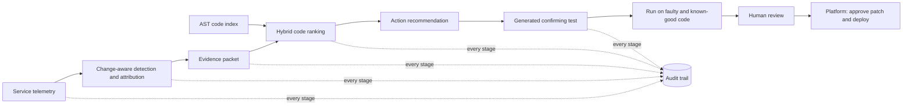

# AIOps Sentinel

AIOps Sentinel is a code-aware AIOps project for services sharing a host. It connects service-level telemetry to source code: detect and attribute a regression, collect a versioned evidence packet, rank likely code locations, generate a test that distinguishes faulty from known-good code, and record the reasoning for review.

The repository contains two related but distinct systems:

1. **The evaluated incident pipeline and Sentinel Console** (`sentinel/`, `shared_server/`, `benchmark/`, `evaluation/`, `panel/`) reproduce incidents and evaluate detection, localisation, test generation, and action decisions.
2. **The Sentinel platform** (`controlplane/`, `samples/`, `deploy/`) runs and manages monitored services, watches their health, rolls back selected deployment failures, investigates incidents, and can apply a proposed patch only after a named human approves it.

The platform is a research/demo system, not a hardened production service. Read the [runbook](docs/RUNBOOK.md) before exposing it on a network. For the project rationale, method, results, and limitations, see the [Project Guide](docs/PROJECT_GUIDE.md). The workflow and stage ownership are in [WORKFLOW.md](docs/WORKFLOW.md).

## Contents

- [Capabilities](#capabilities)
- [How the incident pipeline works](#how-the-incident-pipeline-works)
- [Architecture and repository layout](#architecture-and-repository-layout)
- [Requirements and setup](#requirements-and-setup)
- [Run the evaluated pipeline](#run-the-evaluated-pipeline)
- [Sentinel Console](#sentinel-console)
- [Run the Sentinel platform](#run-the-sentinel-platform)
- [Configuration](#configuration)
- [Evaluation and current results](#evaluation-and-current-results)
- [Safety, boundaries, and limitations](#safety-boundaries-and-limitations)
- [Development](#development)
- [Further documentation](#further-documentation)

## Capabilities

- Monitors a shared-server registry of tenant services and attributes measurements to a service and route.
- Detects changes using per-service and per-route telemetry, robust baseline comparisons, persistence checks, and absolute-change floors. Fixed alert thresholds are retained as a baseline.
- Collects exceptions, stack frames, slow/failed request samples, service ownership, deployment history, behavioural diffs, and blame into a redacted, hashed evidence packet.
- Indexes Python code into AST-derived functions and classes; ranks candidates with BM25, dense embeddings, stack traces, route handlers, call paths, and changed lines.
- Optionally asks a configured LLM to re-rank candidates, generate tests, and propose patches. LLM output is constrained and validated; deterministic methods remain available.
- Runs generated tests in throw-away workspaces against both the incident version and a known-good version. A test confirms a hypothesis only when it fails by assertion on the faulty version and passes on the known-good version.
- Stores deployments, incidents, settings, and audit events in SQLite in platform mode; the benchmark pipeline also writes JSONL audit logs.
- Provides a browser console, incident timeline, source/diff views, test lab, service lifecycle controls, and Prometheus metrics.
- Packages the platform with Prometheus, Alertmanager, cAdvisor, node-exporter, Loki, Promtail, Grafana, and Traefik.

## How the incident pipeline works

The evaluated pipeline implements stages 1–6 below. Audit and guardrails apply throughout. The platform adds service lifecycle management and human-approved patch deployment.



1. **Monitor.** The shared-server sample services record per-route latency, errors, exception events and request samples. Sentinel scrapes service metrics and reads per-process CPU and RSS.
2. **Detect and attribute.** Compare post-change measurements with a pre-change baseline using robust statistics and persistence criteria. Traffic increase alone is not treated as a code fault. Insufficient data yields no conclusion.
3. **Build evidence.** Assemble anomalous signals, exceptions, sampled requests, service owner and code path, and deployment diff/blame. Behaviour-neutral changes are distinguished from syntax-level changes after comments/docstrings are removed. Sensitive strings are redacted before model or audit use.
4. **Index code.** `sentinel/indexing.py` creates function/method, class-header, and module-level chunks from Python ASTs. It records route associations and a lightweight call/reference graph. Retrieval combines identifier-aware BM25 and optional BAAI/bge-small-en-v1.5 dense embeddings (fastembed/ONNX on CPU).
5. **Trace and decide.** `sentinel/tracing.py` combines lexical and dense similarity with stack-frame, route, call-path, behavioural changed-line, and changed-file evidence. The deterministic rank is primary; an optional LLM can re-rank a bounded candidate set. The action is `code_fix`, `capacity_scale`, or `investigate` based on evidence and confidence.
6. **Confirm.** A deterministic template or optional LLM generates a pytest. An AST guard checks generated tests before execution. The runner strips API keys, uses isolated copies and a timeout, and distinguishes assertion failures from crashes.
7. **Human approval and platform response.** The research pipeline records a handoff for human review. In platform mode, crash loops, OOM/memory exhaustion, and failed health checks may trigger an automatic rollback to the last good deployment. Latency/error regressions are investigated and proposed, not automatically patched. A named approver can approve a validated patch; the platform applies it to its managed working copy and uses the normal build and health-gated deployment path.

The production mapping, detector details, retrieval weights, test guard, and design decisions are documented in [PROJECT_GUIDE.md](docs/PROJECT_GUIDE.md) and [WORKFLOW.md](docs/WORKFLOW.md).

## Architecture and repository layout

| Path | Responsibility |
| --- | --- |
| `sentinel/` | Reusable incident pipeline: telemetry, detection, registry, evidence/context, AST index, tracing, LLM client, test generation, audit, orchestration. |
| `shared_server/` | Three sample tenant services (`orders`, `inventory`, `payments`), common telemetry middleware, and `services.yaml` registry used by the evaluated pipeline. |
| `benchmark/` | Ground-truth scenario catalogue, seeded deployment/workspace builder, load generator, recorder, and live demo. |
| `evaluation/` | Benchmark harness, baselines, ablations, scoring tools, and committed results. `evaluation/README.md` has exact commands. |
| `panel/` | Sentinel Console: FastAPI server and browser UI for replay/live benchmark runs and results. |
| `controlplane/` | Platform API/UI, SQLite store, service registry, monitor, detector, policy, investigator, deployer, fault lab, event bus, and Docker/process runtimes. |
| `samples/` | Deployable `orders`, `inventory`, and `payments` services. Each has a `sentinel.json` manifest and health/metrics endpoints. |
| `deploy/` | Platform Compose stack and configuration for Prometheus, Alertmanager, Loki, Promtail, Grafana, Traefik, installation, and systemd. |
| `tests/` | Unit and integration coverage for pipeline, panel, deployment, runtime, and control-plane behaviour. |
| `docs/` | Project guide, workflow, runbook, charter, demo, exercises, responsible-AI notes, design specs, and review materials. |
| `app/`, `services/`, `microservices/`, `web/` | Earlier v0 prototype. Retained for history and baselines; not the current v1 incident pipeline. |
| `Dockerfile`, root `docker-compose.yml` | Earlier v0 prototype stack. The managed platform uses `deploy/docker-compose.yml`. |

### Main runtime relationships

- **Evaluated pipeline:** benchmark recordings and git workspaces → `sentinel.pipeline` → detector/context/index/tracer/test generator → JSONL audit and results.
- **Console:** `python -m panel` → `panel.server` → replay data or live benchmark runner → browser UI.
- **Managed platform:** `python -m controlplane` or the deploy stack → `controlplane.app` → runtime, deployer, monitor, detector and investigator → managed samples or registered Git services.

The benchmark’s `shared_server/services.yaml` ports (9101–9103) and the managed samples’ container port (8000 per service) belong to different execution modes.

## Requirements and setup

- Python 3.11 or 3.12 (project lint target is Python 3.12).
- Git, for benchmark deployment histories and repository inspection.
- For Docker platform mode: Docker Engine and the Docker Compose plugin.
- Optional: an LLM provider key or a local Ollama server. Deterministic ranking and template tests work without an LLM. Dense retrieval may download the embedding model on first use; set `SENTINEL_DENSE=0` to disable it.

Create an environment and install Python dependencies:

```bash
python -m venv .venv
# Linux/macOS
source .venv/bin/activate
# Windows PowerShell: .venv\Scripts\Activate.ps1
python -m pip install --upgrade pip
pip install -r requirements.txt
```

Copy `.env.example` to `.env` and set only the provider configuration you intend to use. Do not commit `.env` or API keys. The project’s LLM adapter supports OpenAI, Groq, and Ollama; see [Configuration](#configuration).

## Run the evaluated pipeline

Run one live end-to-end scenario (starts sample services, generates baseline and incident traffic, and analyzes the recorded deployment):

```bash
python -m benchmark.demo F01
```

Use an existing recording if available, or skip LLM use:

```bash
python -m benchmark.demo F01 --reuse
python -m benchmark.demo F01 --no-llm
```

Scenario IDs are `F01`–`F12` for injected faults and `H01`–`H03` for controls. The current list and fault descriptions are in [`benchmark/scenarios.py`](benchmark/scenarios.py). Benchmark runs create working data under `data/`; generated run data and model caches are not source artifacts.

## Sentinel Console

The Console is a local browser interface for the evaluated pipeline. Replay is the safe default; live mode starts services and runs traffic/deployment steps.

```bash
python -m panel
# http://127.0.0.1:8080

python -m panel --speed 10 --no-browser
```

From the UI, choose a scenario, select replay or live mode, inspect each pipeline stage, source evidence, generated test, and audit events. Approval records a named review event for the benchmark handoff. The Console is separate from the service-managing control plane.

## Run the Sentinel platform

The platform builds and manages services itself. It can monitor the bundled samples or a compatible Git repository. In Docker mode, use the Ubuntu deployment instructions in [RUNBOOK.md](docs/RUNBOOK.md); the Compose file publishes Traefik on host port **8080** by default (`8080:80`). Check the actual host mapping before using URLs from older runbook text.

```bash
cp .env.example .env   # optional provider keys and settings
make up
make ps
```

The Compose command is configured in the Makefile as `docker compose -f deploy/docker-compose.yml`. The dashboard is available at `http://localhost:8080/`; Grafana, Prometheus, and Alertmanager are routed under `/grafana/`, `/prometheus/`, and `/alertmanager/`. The platform state is persisted under `/srv/sentinel` by the server deployment configuration, including SQLite state and managed service workspaces.

For local process mode without Docker:

```bash
python -m controlplane --host 127.0.0.1 --port 8800   # deploys the campus-api environment; add SENTINEL_LAB=1 to offer the synthetic samples
```

Generated traffic goes only to the bundled samples; a cloned Git repository receives none, and the requests you send it (for example with curl through `/svc/<name>/`) are measured at Traefik, so they appear on its Live tab and in Grafana with no change to the app. To disable the generated sample traffic, set `SENTINEL_TRAFFIC=0`. To add another sample or a Git service, use the UI's Add service action. A monitored Git repository needs a Dockerfile and an HTTP app; a `/health` endpoint is used by default. Exposing Prometheus text at `/metrics` enables metric-based monitoring, while lifecycle and resource monitoring can still operate without it.

### Industry environments and independent data

After the review asked for real data and industry relevance, the platform ships **environments backed by real data** and a **data-readiness check**. Study
guide with every number and command: **[docs/ENVIRONMENTS.md](docs/ENVIRONMENTS.md)**.

- **`campus-api`**: a replay of a real campus application built from an anonymised profile of 126,794 logged requests (endpoint mix, latency curves,
  status mix, daily load). It is driven with the real daily load curve (compressed). Changes (`slow_gatepass`, `gatepass_error`) are **injected** and labelled
  as such, so the whole pipeline runs on real traffic shape with a known change time.
- **Industry policy packs** (`environments/policies/`): versioned SLOs per business journey, who may approve, what may be automatic, what is redacted. They gate the
  automatic rollback and the Approve button, and show on each service's **Policy** tab. They are demonstration policies, not any organisation's real ones.
- **Independent evaluation**: `make fetch-data`, then `make eval-rcaeval` (375 real fault-injection cases from Online Boutique, Sock Shop and Train Ticket) and
  `make eval-microsoft` (60 expert-labelled production series). Results appear on the console's Results page.
- **Readiness check**: `python -m evaluation.readiness <file>` (or `make readiness FILE=...`) reports which pipeline stages a company's data can support, and why.
- The console is **light** by default; the button in the top bar switches to dark.

### Platform operations

```bash
make logs       # control-plane logs
make ps         # Compose service status
make config     # validate Compose configuration
make down       # stop platform components; managed service containers are separate
make test       # run pytest
make lint       # run Ruff
make backup     # archive /srv/sentinel (server deployment)
make clean-services  # remove containers labeled as managed by Sentinel
```

From the dashboard, operators can inspect services, deployments, diffs, logs and incidents; restart, stop, start, or roll back a service; configure resource limits; edit the managed working copy; and use Test lab to inject/reset sample faults. Actions and approvals are recorded in the audit trail. Review the runbook for installation, maintenance, security and troubleshooting details.

## Configuration

Settings are read from the environment; `.env.example` is the template. Common options:

| Variable | Default | Purpose |
| --- | --- | --- |
| `SENTINEL_RUNTIME` | `process` | Platform runtime: `process` locally or `docker` in Compose. |
| `SENTINEL_HOME` | `data/sentinel` under the repo | Platform state root (SQLite, service repositories, builds, runs). |
| `SENTINEL_BOOTSTRAP` | `campus-api` (all non-lab samples) | Comma-separated samples to register at startup. |
| `SENTINEL_LAB` | unset | `1` offers the synthetic lab samples (orders, inventory, payments) in Add service. |
| `SENTINEL_REPLAY_DAY_S` | `600` | Seconds one replayed day of campus traffic lasts (the real daily load curve, compressed). |
| `SENTINEL_TRAFFIC` | `1` | Start generated sample traffic at platform startup (`0` disables it). |
| `SENTINEL_USE_LLM` | `1` | Allow optional LLM investigation steps when credentials are available (`0` disables). |
| `SENTINEL_DENSE` | `1` | Allow dense embedding retrieval (`0` disables). |
| `SENTINEL_MONITOR_INTERVAL_S` | `1` | Platform sampling interval in seconds. |
| `SENTINEL_HEALTH_TIMEOUT_S` | `30` | Deployment health-gate timeout. |
| `SENTINEL_STABILITY_WINDOW_S` | `120` | Stability period used by platform deployment/policy. |
| `SENTINEL_REGRESSION_AFTER_S` | `60` | Delay before checking a deployment for regressions. |
| `SENTINEL_DEFAULT_MEM_MB` | `256` | Default managed-service memory limit. |
| `SENTINEL_DEFAULT_CPUS` | `0.5` | Default managed-service CPU limit. |
| `SENTINEL_NETWORK` | `sentinel` | Docker network for managed containers. |
| `SENTINEL_LOKI_URL` | unset | Loki endpoint for log enrichment (Compose sets it). |
| `SENTINEL_PROMETHEUS_API` | unset | Prometheus API used to read Traefik's per-service request metrics for services without their own telemetry (Compose sets it). |
| `OPENAI_API_KEY` | unset | OpenAI credentials; selected by default when present. |
| `OPENAI_MODEL` | adapter default | OpenAI model override. |
| `OPENAI_REASONING_EFFORT` | `medium` | OpenAI reasoning effort setting. |
| `GROQ_API_KEY` | unset | Groq credentials; used when selected and available. |
| `GROQ_MODEL` | adapter default | Groq model override. |
| `SENTINEL_LLM` | auto | Provider selector: `openai`, `groq`, or `ollama`. |
| `OLLAMA_BASE_URL` | `http://localhost:11434` | Local/remote Ollama API URL. |
| `OLLAMA_MODEL` | `qwen2.5-coder:7b` | Ollama model name. |

The exact defaults and available settings can change; inspect [`controlplane/config.py`](controlplane/config.py), [`sentinel/llm.py`](sentinel/llm.py), and `.env.example` when configuring a checkout.

## Evaluation and current results

The benchmark contains 12 code faults and 3 controls, each run with three seeds (45 recordings total). It compares the change-aware detector with fixed thresholds; hybrid code tracing with v0 retrieval, blame-recent-changes, BM25, dense, plain RAG+LLM and ablations; test generators; and action policy with “scale on every alert.” Seeds 1–2 are held out from development. See [evaluation/README.md](evaluation/README.md) to reproduce and [evaluation/results/summary.md](evaluation/results/summary.md) for the generated tables.

Selected recorded results:

| Measure | Result | Scope |
| --- | ---: | --- |
| Change-aware detection recall | 92% (33/36) | Fault scenarios; correctly attributed to the service first in 92%. |
| Quiet-deployment false alarms | 33% (2/6) | H01/H02 runs; detector trade-off. |
| Deterministic hybrid function Top-1 | 85% | 33 detected fault recordings; 86% on held-out seeds. |
| Hybrid + primary LLM function Top-1 | 82% | Same 33 recordings; did not beat deterministic hybrid Top-1. |
| Template confirming-test rate | 94% | 33 detected fault recordings. |
| Primary LLM confirming-test rate | 91% | 33 detected fault recordings. |
| Evidence-driven action accuracy | 82% | 45 total runs; “scale on every alert” scored 13%. |

These numbers describe the small, authored Python benchmark, not production performance. F09’s subtle latency regression was not detected in any seed; two of six quiet deployments caused false incidents. The benchmark’s faults and tracer are authored together, there are only 15 scenarios, and all faults are change-induced. LLM test results for the comparison model have a smaller sample due to provider limits. Detailed misses, ablations, and interpretation are in the Project Guide.

Older v0 retrieval evaluation assets under `evaluation/run_evaluation.py` and `evaluation/results/` are retained for historical comparison. They are not the v1 fault-ground-truth evaluation.

## Safety boundaries and limitations

- **Human decision boundary:** incident evidence and model output do not authorize a code change. Platform patch application requires a named approver. Automatic rollback is limited to configured unhealthy lifecycle/resource conditions; latency and error regressions are proposed for review.
- **Test isolation:** generated tests run on temporary copies with API keys removed, a static AST guard, and a timeout. This is a useful safety layer, not a hardened hostile-code sandbox.
- **Tenant scope:** code retrieval is scoped to the registered service and allowed shared code in the pipeline. Production use would need stronger identity, authorization, and repository isolation.
- **Platform privilege:** Docker runtime needs access to the Docker socket, which is effectively host-root access. Keep the platform on a trusted network and add authentication/TLS before exposing it. Grafana anonymous viewer access is enabled by the provided Compose configuration.
- **Data retention:** SQLite, logs, generated samples, test code, deployment snapshots, and audit events may contain operational details. Set access and retention policies appropriate to the environment.
- **Detection limits:** the detector needs enough before/after measurements and a known change boundary. Hand-set floors miss small regressions; noisy routes can cause false alerts.
- **Retrieval and model limits:** Python AST indexing is not a general multi-language code index. Dense model availability/download, stale indexes, incomplete telemetry, model errors, unsupported claims, and output variability can affect diagnosis. LLM output is validated but still requires review.
- **Test limits:** timing and memory tests can be sensitive to shared machine load. Passing the faulty/known-good test pair is evidence for a hypothesis, not proof of a safe remediation.
- **Not implemented/evaluated end to end:** automatic PR creation, CI/CD integration, staged rollout, and post-deploy watch in the original research workflow. Platform-managed patch approval/deployment is a local control-plane feature and is not covered by the 45-run benchmark scores.

## Development

Run the repository checks:

```bash
make test
make lint
```

Equivalent commands:

```bash
python -m pytest -q
ruff check controlplane samples tests panel sentinel benchmark evaluation
```

To regenerate the benchmark result files, follow [`evaluation/README.md`](evaluation/README.md). A complete record/analyze run can take tens of minutes and may make paid LLM requests. The Console can replay existing data without rerunning the benchmark.

## Further documentation

- [Project Guide](docs/PROJECT_GUIDE.md): research questions, detailed methods, evaluation design/results, limits, team ownership.
- [Workflow](docs/WORKFLOW.md): stage-by-stage operational flow and owners.
- [Runbook](docs/RUNBOOK.md): platform installation, operation, incident demo, troubleshooting, and uninstall.
- [Industry environments](docs/ENVIRONMENTS.md): study guide for the real-data environments, policy packs, independent evaluation, readiness check and how to run it all on a new server.
- [Project status](docs/PROJECT_STATUS.md): what is done, what is left, future scope.
- [Individual work](docs/INDIVIDUAL_WORK.md): each member's part and the questions to expect.
- [Review response](docs/REVIEW_RESPONSE.md): answers to reviewers' comments, confidence intervals, trade-offs, related work.
- [Research comparison](docs/RESEARCH_COMPARISON.md): how Sentinel relates to RCACopilot, in-context GPT-4 RCA, LLM agents and Meta's just-in-time tests.
- [Demo script](docs/DEMO_SCRIPT.md): suggested walkthrough.
- [Exercises](docs/EXERCISES.md): project learning exercises.
- [Responsible AI and prompts](docs/PROMPTS_AND_RESPONSIBLE_AI.md): prompt and safety discussion.
- [Project charter](docs/PROJECT_CHARTER.md): scope, team and success criteria.
- [Evaluation instructions](evaluation/README.md): record, analyze, compare models, and score.
- Design documents: [`docs/superpowers/specs/`](docs/superpowers/specs/) and [`docs/superpowers/plans/`](docs/superpowers/plans/).
- Review deck: [`docs/AIOps_Sentinel_Review.pptx`](docs/AIOps_Sentinel_Review.pptx).
