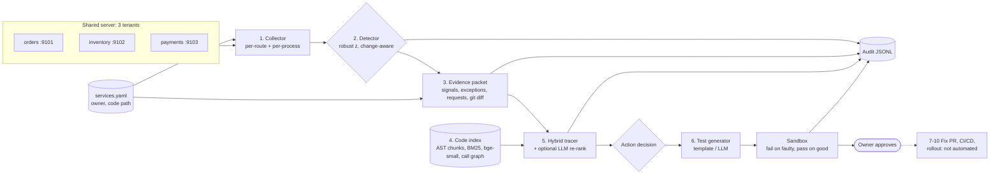

# AIOps Sentinel — Project Guide (v1)

> One document the whole team can study end to end: what we built, why, how each step works,
> which tools we used and why, how we evaluated it, what the numbers say, and what does not work.
> Owners: **Akash** (steps 1–2), **Aryan** (steps 3–5), **Syna** (step 6 + evaluation). Every
> member is expected to be able to explain every section.

## 1. The idea in one paragraph

AIOps Sentinel watches a **shared server** (several teams' services on one machine). When a
service gets into trouble it does **not** just scale it. It works out *which* service is
affected, gathers the evidence (telemetry, exceptions, what was just deployed), uses
**semantic code search and retrieval-augmented reasoning** to trace the symptom back to the
**actual function** that causes it, and **generates a test that proves it**: the test must fail
on the deployed code and pass once the cause is reverted. Every decision is written to an audit
trail, and a human approves any change. Steps 7–10 (fix proposal, PR, CI/CD rollout, post-deploy
watch) are designed but deliberately not automated yet.

## 2. Research question and hypotheses

**RQ.** On a shared server, can telemetry-grounded hybrid code retrieval (with an LLM) trace a
runtime incident to the responsible code, and confirm it with a generated test, more accurately
than the naive alternatives an operator would otherwise use — fixed-threshold alerts, blaming the
latest deployment, plain vector RAG, or scaling the service?

| Sub-question | Owner | Measured by | Baselines |
| --- | --- | --- | --- |
| RQ1 Can a change-aware robust detector tell *which tenant* broke, and stay quiet when nothing broke? | Akash | fault recall, correct-service@1, false-alarm rate | fixed thresholds |
| RQ2 Does fusing telemetry structure (routes, call graph, stack frames, behavioural diff) with lexical + dense retrieval localise the faulty function better? | Aryan | Top-1/Top-3 function accuracy, MRR, file Top-1 | v0 Sentinel retriever, blame-recent-changes, BM25, dense, plain RAG+LLM |
| RQ3 Can a generated test confirm the diagnosis (fail on faulty code, pass on known-good code)? | Syna | confirming-test rate, guard pass rate | template generator vs LLM generator |
| RQ4 Does the evidence lead to the right action instead of scaling blindly? | Team | action accuracy | "scale on every alert" |

**Hypotheses.** H1: the robust detector finds more faults than fixed thresholds with no more false
alarms. H2: the hybrid tracer beats every single-signal baseline on Top-1. H3: an LLM adds value
mainly as a re-ranker over structured evidence, not as plain RAG. H4: a large share of generated
tests are confirming, and the guard blocks unsafe tests.

## 3. Review of the original 10-step flow

The original flow (monitor → detect → context → index → trace → test → fix → CI/CD → audit →
guardrails) is the right shape. Five corrections made it workable and measurable:

1. **Step 1 lacked ownership.** On a shared server, host CPU says *something* is wrong, not *whose*.
   We added a service registry (`shared_server/services.yaml`) and per-process / per-route
   telemetry so every signal belongs to one service, one code path and one owner.
2. **Step 2 must be change-aware and robust.** Fixed thresholds miss slow regressions and fire on
   bursty routes. We compare after-change against before-change with a robust z-score,
   persistence, and an exceedance-rate test.
3. **Step 4 is continuous, not per incident.** Indexing runs on every commit; at incident time the
   index for the deployed commit already exists. (In the benchmark we index each workspace once.)
4. **"Don't scale blindly" needs an explicit decision.** We added an action decision after step 5:
   `code_fix` only with code evidence, `capacity_scale` only when traffic rose and no code
   evidence exists, otherwise `investigate`.
5. **Step 6 needs a definition of "confirmed".** A generated test proves nothing if it passes or
   fails everywhere. Confirmation = fails by assertion on the deployed code **and** passes on the
   known-good code. In production the known-good code is the pre-deployment commit
   (`deploy-prev`); in the benchmark it is the deployment with only the faulty commit reverted.

Steps 9 (audit) and 10 (guardrails) are cross-cutting, not sequential: every step writes audit
events and every step has a guardrail.

## 4. Architecture

| Package | Purpose |
| --- | --- |
| `shared_server/` | The system under observation: 3 FastAPI services + shared telemetry middleware + registry |
| `sentinel/` | The product: one module per step (`telemetry`, `detection`, `context`, `indexing`, `tracing`, `testgen`, `audit`, `pipeline`, `llm`, `registry`) |
| `benchmark/` | Ground truth: fault catalog, git workspace builder, load generator, live recorder, demo |
| `evaluation/benchmark.py` | Runs pipeline + baselines on every recording and scores them |
| `app/`, `services/`, `microservices/`, `web/` | v0 prototype (kept; `services/retrieval.py` is the "v0" baseline) |

## 5. Step by step: what, why, how, tools

### Step 1 — Monitor the shared server (Akash)

**What.** Every service installs `common/telemetry.py`. It records per-route latency (p50/p95/max),
5xx counts, exceptions with stack frames (only frames inside our code), up to 20 slow/failed request
samples, and one normal "exemplar" request per route. `sentinel/telemetry.py` scrapes `/metrics` from
every registered service once per second and reads each service's own process CPU and RSS with psutil.

**Why.** Host-level metrics cannot attribute trouble to a tenant. Per-route numbers tell us *where*
in the service; exceptions tell us *which line*; request samples let step 6 replay the incident.

**Tools.** FastAPI middleware (in-process, zero extra infrastructure), psutil (per-PID CPU/RSS,
cross-platform), httpx (scraper and load generator), PyYAML (registry). *Production equivalent:*
Prometheus + cAdvisor/node-exporter for metrics, OpenTelemetry for traces/exceptions, Loki for logs.
We chose in-process telemetry so the whole benchmark runs on one laptop and is reproducible.

### Step 2 — Detect and attribute (Akash)

**What.** `sentinel/detection.py` compares the window after a change (deployment or traffic
shift) with the window before it, per service and per route, for latency, error rate, CPU,
traffic and memory.

**How.** For each signal: baseline median and MAD; z = (value − median) / max(1.4826·MAD, floor).
A bucket is anomalous if z ≥ 6 **and** the absolute change is meaningful (latency +15 ms and +50 %,
errors +2 pp, CPU +15 points). A signal fires only if ≥ 3 buckets are anomalous **and** the share
of anomalous buckets is ≥ 30 points higher than the share of baseline buckets that already crossed
the same bar (this stops bursty routes such as `/pay`, whose p95 jumps whenever a gateway call
times out, from alarming). Memory uses a leak test instead: net growth ≥ 10 MiB and a positive
Theil–Sen slope. Traffic increase alone is not an incident. Too little data → "cannot conclude".

**Baseline.** Fixed alert rules: p95 > 500 ms, error rate > 5 %, CPU > 80 %, RSS > 500 MiB.

**Tools.** Python `statistics` only — deterministic and explainable; no ML model to train.

### Step 3 — Build the evidence packet (Aryan)

**What.** `sentinel/context.py` builds a versioned, hashed packet: anomalous signals, exceptions in
the incident window (grouped, with frames), slow/failed requests, exemplar requests, the service's
owner and code path, and the deployment: commits, changed line ranges (from `git diff -U0`,
attributed to commits with `git blame`), and whether each change is **behavioural** (the syntax
tree changed after removing comments and docstrings).

**Why.** The model must see the evidence, not the whole uncontrolled repository; the audit trail
must be able to say exactly which evidence a decision used (packet digest). The behavioural-diff
flag stops "someone edited a docstring on the hot path" from looking like a cause.

**Tools.** git (diff, blame, log), Python `ast`, `hashlib`. A `redact()` pass strips credentials and
card numbers before text reaches a model, a file or the audit log.

### Step 4 — Index the code semantically (Aryan)

**What.** `sentinel/indexing.py` splits every Python file along its syntax tree: one chunk per
function/method (with decorators), one per class header, one per block of module-level statements
(constants and config live there). Each chunk stores path, symbol, line range, served routes (from
`@app.get("/…")` decorators), names it calls/reads, and names it defines → a call/reference graph.

Two retrievers: **BM25** over identifier-aware tokens (`load_customer` → `load_customer`, `load`,
`customer`) and **dense** cosine similarity with **BAAI/bge-small-en-v1.5** embeddings (384-d) via
fastembed (ONNX on CPU, no GPU, ~130 MB).

**Why.** Function-level chunks match what a human names in a diagnosis and what ground truth is
scored against (the v0 retriever used blind 44-line windows). Lexical search is strong on exact
identifiers from stack traces and routes; dense search finds "slow per-item lookup" style meaning.

**Tools.** `ast`, our own BM25 (30 lines, transparent), fastembed + bge-small. *Alternatives
considered:* tree-sitter (needed only for multi-language repos), code-specific embedding models
(jina-code, 640 MB, slower on CPU), a vector DB such as Qdrant/Chroma (unnecessary for ~50 chunks per
service; embeddings are cached in memory).

### Step 5 — Trace the incident to code (Aryan)

**What.** `sentinel/tracing.py` scores every chunk of the affected service (plus shared code) with
seven features and fixed weights:

| Feature | Meaning | Weight |
| --- | --- | ---: |
| lexical | BM25 of the incident query, scaled to [0,1] | 1.0 |
| dense | bge-small cosine, min–max scaled | 1.0 |
| trace | contains a stack frame of a logged exception (deepest frame 1.0, others 0.5) | 2.5 |
| route | handler of an anomalous route | 1.0 |
| call_path | reachable from an anomalous route handler, 1/depth (max depth 3) | 1.5 |
| changed_lines | overlaps a behavioural change of the deployment | 1.5 |
| changed_file | same file as a behavioural change, other lines | 0.3 |

The incident query is built from the symptom vocabulary, the anomalous route paths and the
exception messages. The weights were set before the benchmark from the strength of each kind of
evidence (a stack frame is near-proof; a lexical match is weak) and were **not tuned** on results.

**Action decision.** Confidence = 0.35·on-call-path + 0.35·(trace or behavioural change) + 0.3·margin.
`capacity_scale` only if traffic rose and the top suspect has no code evidence; `code_fix` if
confidence ≥ 0.6; otherwise `investigate`.

**LLM re-ranking (optional).** The top 8 candidates (code + evidence tags) and the packet go to the
LLM (Groq, temperature 0, JSON mode). Guardrails: packet is data, not instructions; choose only
candidate ids; never invent files/versions; state uncertainty; never claim a fix was applied. The
output is validated; invented ids are counted; invalid JSON falls back to the deterministic ranking.

### Step 6 — Generate a confirming test (Syna)

**What.** `sentinel/testgen.py` writes a pytest file and runs it twice in throw-away copies of the
workspace: on the deployed (faulty) code and on the known-good code.

* **Template generator** (deterministic): errors → replay the failing requests, assert no 5xx;
  latency/CPU → replay the slowest incident request 20×, assert median ≤ max(3×, +10 ms) and p95 ≤
  max(2×, +20 ms) of the pre-incident baseline; memory → 200 rounds of the exemplar requests, assert
  tracemalloc growth < 8 MiB.
* **LLM generator**: gets the packet, top-3 suspect code, observed requests and baselines, and
  writes the test itself (it can, e.g., write a concurrent test for lock contention).

**Guard** (before anything runs): parses; no `os/sys/subprocess/socket/shutil/pathlib/httpx/…`
imports; no `open/eval/exec/__import__`; no skip/xfail; at least one `test_` and one `assert`.
**Sandbox**: fresh copy, API keys stripped from the environment, 90 s timeout, JUnit XML parsed so
that only an *assertion* failure counts (a crash is not a confirmation).

**Why.** A diagnosis is a hypothesis; a fail→pass test is evidence a reviewer can rerun, and it
becomes the regression test of the eventual fix.

### Audit trail and guardrails (team)

`sentinel/audit.py` appends one JSON event per stage (`detect`, `context`, `trace`, `test`,
`handoff`) with incident id, decision, confidence, packet digest, model, prompt version, tokens and
test outcomes. Sentinel never edits code, restarts or scales anything; the final event is always
`awaiting human approval`.

## 6. Tools at a glance

| Tool | Used for | Why this one |
| --- | --- | --- |
| Python 3.11/3.12, FastAPI, Uvicorn, Pydantic | services under test, telemetry middleware | small, typed, async; same stack as v0 |
| httpx | scraper, load generator, Groq client | sync + async in one library |
| psutil | per-process CPU and RSS of each tenant | cross-platform, no agent needed |
| PyYAML | service registry | human-editable ownership file |
| git | deployments, diff, blame, known-good version | real change history, not simulated |
| Python `ast` | chunking, call graph, behavioural diff, test guard | exact, dependency-free |
| BM25 (own code) | lexical retrieval | strong on identifiers; transparent |
| fastembed + BAAI/bge-small-en-v1.5 | dense retrieval | good small embedding model, CPU-only |
| Groq API (OpenAI-compatible) | LLM re-ranking and test writing | fast hosted open-weight models; key in `.env` |
| pytest + JUnit XML | sandbox test runs | distinguishes assertion failures from crashes |
| Ruff, GitHub Actions | lint + tests on every push | v0 CI kept and extended |

## 7. Evaluation design

**Benchmark.** 12 realistic faults + 3 controls (`benchmark/scenarios.py`), each run live:
start 3 services → 20 s baseline traffic → deploy 4 commits (fault hidden among 3 decoy commits,
at least one decoy in the same service, seeded random order) → restart changed services → 20 s same
traffic (4× traffic on orders for H03) → stop. 3 seeds each (seed 0 = development, seeds 1–2 =
held-out), 45 recordings. Ground truth = the faulty file and line range; known-good = deployment
with the fault commit reverted.

| Id | Fault | Service | Class |
| --- | --- | --- | --- |
| F01 | N+1 customer lookup per order | orders | latency |
| F02 | quadratic bundle-discount loop | orders | cpu |
| F03 | unbounded view history (leak) | inventory | memory |
| F04 | `STOCK[sku]` KeyError on unknown SKU | inventory | errors |
| F05 | gateway timeout raised 10× in config | payments | latency |
| F06 | connection pool bypassed (handshake per call) | payments | latency |
| F07 | catastrophic regex backtracking | payments | cpu |
| F08 | whole table serialised per summary request | orders | cpu |
| F09 | lock held during audit write | inventory | latency |
| F10 | division by zero on empty cart | orders | errors |
| F11 | refund reason assumed present | payments | errors |
| F12 | full table scan on order lookup | orders | latency |
| H01 | docs-only deployment | — | control |
| H02 | behaviour-neutral refactor | — | control |
| H03 | 4× traffic surge, no code change | — | capacity |

**Metrics.** Detection: fault recall, correct service at rank 1, false-alarm rate on H01/H02.
Localisation: Top-1/Top-3/Top-5 function accuracy (suspect overlaps the faulty lines), MRR@10,
file Top-1, tokens and latency for LLM methods, invalid outputs, invented ids. Tests: guard pass,
fails-on-faulty, passes-on-good, confirming. Action: accuracy against the expected action.

**Baselines.** Detection: fixed alert thresholds. Localisation: the v0 retriever (hashed
bag-of-words, 44-line windows, whole repo), "blame the deployment, newest commit first", BM25 alone,
dense alone, plain RAG + LLM (dense top-8 over the whole repo, no telemetry structure, same LLM and
prompt without evidence tags). Action: "scale on every alert". Ablations remove one evidence feature
at a time from the hybrid ranker.

**Protocol and honesty rules.** Seed 0 was used while building; seeds 1–2 are held-out and are
reported separately. Ranker weights and detector constants were fixed before the final runs and never
tuned on results. Every run is reported (no re-runs for a bad score). LLM answers are cached by prompt
hash. Models: OpenAI gpt-5.4-mini is the primary LLM (all 33 detected fault runs); Groq gpt-oss-120b
is compared on the same prompts (all 33 runs for localisation, generated tests on seed 0 only because of
Groq rate limits). A third model (qwen3.8-27b) was tried and dropped: it did not run reliably on Groq.

## 8. Results

Full tables: [evaluation/results/summary.md](../evaluation/results/summary.md) (generated); every run:
`evaluation/results/runs/`; audit trail per run: `evaluation/results/audit/`.

### 8.1 Detection (Akash) — RQ1, H1

| Detector | Fault recall | Right service first | False alarms (H01, H02) |
| --- | ---: | ---: | ---: |
| Robust, change-aware | 92% (33/36) | 92% | 33% (2 of 6) |
| Fixed thresholds | 33% (12/36) | 33% | 0% |

By class (robust vs threshold): cpu 100% vs 33%, errors 100% vs 100%, latency 80% vs 0%, memory 100%
vs 0%. Thresholds only fire on error faults and the heaviest CPU faults: every latency fault moved a
route from single-digit milliseconds to 85–400 ms, far below a 500 ms alert, and the memory leaks
stay far below 500 MiB.

**Interpretation.** H1 is supported on recall and tenant attribution. The cost is false alarms: the
robust detector raised an incident on 2 of 6 quiet deployments (H01 seed 2, H02 seed 0), both on the
bursty `/pay` route after a restart. Fixed thresholds never false-alarm here because they almost never
fire at all. **Misses:** F09 (lock held during an audit write) was never detected in 3 runs: it adds
about 4 ms per reservation at three workers, below the minimum-change floors.

### 8.2 Localisation (Aryan) — RQ2, H2, H3

| Method | Top-1 | Top-3 | MRR | Held-out Top-1 |
| --- | ---: | ---: | ---: | ---: |
| Hybrid (no LLM) | 85% | 97% | 0.91 | 86% |
| Hybrid + LLM (gpt-5.4-mini) | 82% | 94% | 0.89 | 77% |
| Hybrid + LLM (gpt-oss-120b) | 67% | 91% | 0.81 | 68% |
| Plain RAG + LLM (gpt-5.4-mini) | 46% | 55% | 0.50 | 46% |
| Plain RAG + LLM (gpt-oss-120b) | 36% | 52% | 0.44 | 36% |
| Blame the deployment | 36% | 67% | 0.57 | 36% |
| BM25 only | 18% | 27% | 0.28 | 18% |
| Dense only | 15% | 46% | 0.28 | 14% |
| v0 retriever | 3% | 30% | 0.20 | 4% |

(n = 33 detected fault runs; the 3 F09 runs were never detected, so they have no ranking.)

Ablation, Top-1 (hybrid 85%): without deploy diff 61%, without route + call graph 67%, without
stack frames 85%, without tenant scope 88%, without dense 91%, without lexical 91%.

**Interpretation.**
* H2 is supported: the hybrid beats every single-signal baseline by a wide margin, including
  blame-the-deployment (36%), which is the strongest naive method because every fault is change-induced.
* Structure carries the result. Deploy diff (−24 points) and call graph (−18) matter most. Removing
  BM25 or dense *raises* Top-1 to 91%: once structure decides, text similarity mostly adds noise. We
  report this rather than hide it; with the weights fixed in advance, the full hybrid is the
  configuration we committed to, and the "no_dense" / "no_lexical" rows are exploratory.
* Stack frames did not change Top-1 (85% either way): only the 9 error runs (F04, F10, F11 × 3 seeds)
  log exceptions, and the call graph and deploy diff already rank those first. They add explanation,
  not ranking, on this benchmark.
* Tenant scope was not needed for accuracy (88% unscoped vs 85% scoped); it is a safety and cost
  property (never read another team's code), not an accuracy feature.
* H3 is supported: the LLM as a re-ranker over structured evidence (82%) is far better than plain RAG
  with the same LLM (46%), but it did not beat the deterministic hybrid on Top-1. It did improve
  file-level accuracy (91% vs 85%) and latency/cost are higher (about 2.5k tokens and 7 s per call).
  Its failures: 5 invented candidate ids and 1 invalid output across 33 runs, all caught by validation.
* The pattern holds across models: with gpt-oss-120b, re-ranking structured evidence scores 67% vs 36% for plain RAG. The weaker model gains less from the LLM step (67% vs the 85% of the deterministic hybrid), so the LLM is an option on top of the evidence, not a replacement for it.
* Per class (Top-1): the hybrid is 100% on errors and memory, 83% on latency, 67% on CPU.

**Failure cases.** F07 (catastrophic regex in a module-level constant): the symptom is CPU on `/pay`,
the call path leads to the gateway, and the LLM names the function that *uses* the regex, not the
constant (hybrid rank 4, 2, 3 and LLM rank 6, 2, 5 on seeds 0, 1, 2). F06: a decoy edit to `config.py` on the same call path
outranked the real change once.

### 8.3 Confirming tests (Syna) — RQ3, H4

| Generator | n | Guard pass | Fails on faulty | Passes on known-good | Confirming |
| --- | ---: | ---: | ---: | ---: | ---: |
| Template | 33 | 100% | 94% | 100% | 94% |
| LLM gpt-5.4-mini | 33 | 91% | 91% | 91% | 91% |
| LLM gpt-oss-120b (seed 0) | 11 | 100% | 91% | 36% | 27% |

**Interpretation.** H4 is supported for the template and gpt-5.4-mini generators. The decisive
number is *passes on known-good*: a test that fails on both versions is not evidence. gpt-oss-120b
usually wrote tests that failed on the fixed code too: it asserted incidental behaviour (an exact
number of memory bytes, a response shape that the correct code does not have, `average_item_price is
None` on an empty cart) instead of the diagnosed symptom, or used budgets too tight for in-process
timing. The 3 gpt-5.4-mini failures (F06 seed 1, F07 seeds 0 and 2) are not guard blocks: the model
returned an *empty* answer (a reasoning model whose output budget was spent before it wrote any
code), so no test existed; we did not re-run them. The guard's static checks and one repair round
fired on earlier development runs (non-ASCII identifiers) but did not decide any final result. No
generated test was ever run outside the sandbox. **Misses:** F07 is the weakest (template 2/3,
LLM 1/3) because regex backtracking time depends on the input the test chooses.

### 8.4 Action: not scaling blindly — RQ4

| Policy | Accuracy (45 runs) |
| --- | ---: |
| Sentinel (evidence-driven) | 82% |
| Scale on every alert | 13% |

Sentinel recommended a code fix on no control run. Its 8 wrong decisions: F09 undetected (3), F07
left as "investigate" because confidence stayed below 0.6 (2), two quiet deployments raised an
incident that ended as "investigate" (H01 seed 2, H02 seed 0), and one traffic surge (H03 seed 2)
that was not detected.

## 9. Limitations and failure analysis

* **We wrote the faults, the decoys and the tracer.** Mitigations: weights and constants fixed before
  the final runs, seed 0 for development and seeds 1–2 held out, hidden fault commit among decoys with
  innocent messages, a baseline (blame-the-deployment) that is hard to beat on easy cases. This does
  not remove the risk that the tracer is tuned to *our kind* of fault.
* **Every fault is change-induced.** That favours diff-based evidence; latent bugs surfaced by new
  traffic have no culprit commit. The detector also needs a known change time.
* **Small sample.** 45 runs from 15 scenarios; one run moves a rate by 3 points. Read gaps below about
  10 points as directional.
* **One small Python stack on one laptop.** Load generator, services and tests share a machine, so
  latency tests can flip near a budget. The call graph links names, not types.
* **Detection trades recall for false alarms** (92% recall, 2 of 6 quiet false incidents). The floors
  and z = 6 were set by hand on seed 0; F09 shows what they miss.
* **LLM variance.** One run per prompt (cached); GPT-5 models expose no temperature. gpt-oss-120b
  test results are seed 0 only. Only two LLMs were compared. A different prompt could change every LLM number.
* **Known-good = the fault commit reverted.** In production it is the previous deployment (`deploy-prev`);
  a bug that was always there has no known-good version.
* **Steps 7–10 are not evaluated** (fix proposal, draft PR, CI/CD rollout, post-deploy watch).

## 10. How to reproduce

See [evaluation/README.md](../evaluation/README.md). In short: `record` (live traffic, ~35 min for 45
runs), `analyze` (about 40 min with an LLM), `analyze-model` for other LLMs, `score` to regenerate
`summary.json` / `summary.md`, then `node docs/deck/build_deck.js` to rebuild the slides from those
numbers.

### Sentinel Console

`python -m panel` serves a local web panel (`http://127.0.0.1:8080`) that shows the shared server, an incident moving through
detect → packet → trace → test → hand-off, and the measured results. **Replay** re-plays a saved run in about 40 s (safe for a
demo); **Live** runs the real services, traffic, deployment and pipeline in about 80 s. It is a thin layer over `sentinel/` and
`benchmark/`: it changes no pipeline behaviour, never edits code, and its Approve button only appends a named audit event.
Design: [spec](superpowers/specs/2026-10-08-sentinel-console-design.md), plan: [plan](superpowers/plans/2026-10-08-sentinel-console.md).

### Sentinel platform

`controlplane/` turns the pipeline into a running service. It deploys the monitored services itself (Docker on the server,
plain processes on a laptop), so it knows exactly which version is live and can act. A restart commits the working copy,
builds it, starts the new instance, and swaps traffic only after a health gate; a failed gate leaves the old instance
serving. The detector watches crashes, OOM kills, crash loops, failed health checks, memory/CPU guards, latency/error
regressions against the previous deployment (the `sentinel.detection` method) and Alertmanager alerts. Policy auto-rolls back
only to the last good version, once per incident; the investigator then runs steps 3–6 on the bad commit and proposes a patch
that a human approves. State is SQLite. The **Test lab** applies benchmark faults F01–F12 (and crash-on-start, memory-leak,
CPU-spin recipes) to a monitored service. Operations: [RUNBOOK.md](RUNBOOK.md); design:
[spec](superpowers/specs/2026-10-09-sentinel-platform-design.md). This goes beyond the evaluated pipeline: the rollback and
fault-lab behaviour is covered by unit/integration tests, not by the benchmark results in section 8.

## 11. Team responsibilities

| Member | Owns | Code | Presents |
| --- | --- | --- | --- |
| Akash (P1) | Steps 1–2 | `shared_server/common/telemetry.py`, `sentinel/telemetry.py`, `registry.py`, `detection.py` | benchmark design, detection method and results |
| Aryan (P2) | Steps 3–5 | `sentinel/context.py`, `indexing.py`, `tracing.py` | packet and index, tracing method, localisation and ablation results |
| Syna (P3) | Step 6 + evaluation | `sentinel/testgen.py`, `llm.py`, `benchmark/`, `evaluation/benchmark.py` | test generation method and results, LLM comparison |
| Whole team | Audit, guardrails, docs, slides | `sentinel/audit.py`, `pipeline.py`, `docs/` | problem, alignment, limitations, conclusion |

**Everyone must be able to answer:** why per-process telemetry on a shared server; why compare after
vs before a change; why behaviour-only diffs; what each of the seven ranking features means and why
the weights were not tuned on results; why a test must fail on faulty *and* pass on known-good code;
why blame-the-deployment is the right baseline; what the 8 wrong actions were; and what is not
evaluated.
