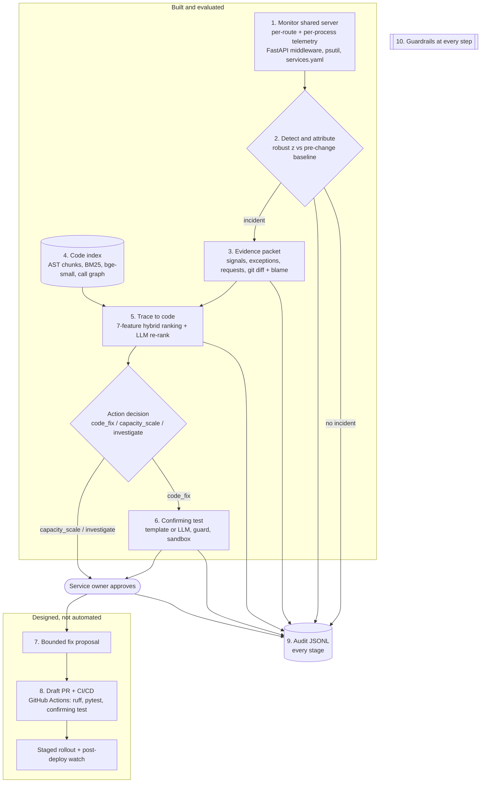

# AIOps Sentinel — Workflow and Tooling (v1)

The full rationale, method and results are in [PROJECT_GUIDE.md](PROJECT_GUIDE.md). This page is
the operational view: the ten steps, who owns each, what tool does it, and what is built.

## End-to-end workflow

## Steps, owners, tools, status

| # | Step | Owner | Tools | Status |
| --- | --- | --- | --- | --- |
| 1 | Monitor shared server: per-route latency/errors, per-process CPU/RSS, exceptions, request samples, registry | Akash | FastAPI middleware, psutil, httpx, PyYAML | Built |
| 2 | Detect and attribute to a tenant, change-aware robust z-score; fixed-threshold baseline | Akash | Python `statistics` | Built + evaluated |
| 3 | Evidence packet: signals, grouped exceptions, requests, deployment diff with blame and behavioural flag, redaction, digest | Aryan | git, `ast`, `hashlib` | Built |
| 4 | Code index: AST function chunks, routes, call graph, BM25, dense embeddings | Aryan | `ast`, own BM25, fastembed + BAAI/bge-small-en-v1.5 | Built |
| 5 | Trace: hybrid 7-feature ranking scoped to the tenant; LLM re-rank with id validation; action decision | Aryan | OpenAI gpt-5.4-mini (Groq gpt-oss-120b compared) | Built + evaluated |
| 6 | Confirming test: template + LLM generators, AST guard, sandbox run on faulty and known-good code | Syna | pytest, JUnit XML, subprocess sandbox | Built + evaluated |
| 7 | Bounded fix proposal (diff, rationale, risk, rollback) | Team | — | Designed |
| 8 | Draft PR, CI validation including the confirming test, approval gate | Team | GitHub Actions (CI exists: ruff + pytest) | Partly (CI only) |
| 9 | Audit trail of every decision | Team | JSON Lines | Built |
| 10 | Guardrails: tenant scope, redaction, JSON-only LLM output, test guard, sandbox, no write access, human approval | Team | — | Built (for steps 1–6) |

## Production mapping

| Benchmark component | Production equivalent |
| --- | --- |
| In-process telemetry middleware | OpenTelemetry SDK + Prometheus/cAdvisor + Loki |
| `services.yaml` | Kubernetes labels / service catalogue (Backstage) |
| git workspace with `deploy-prev` / `deploy-current` tags | CD system deployment events + repository at the deployed SHA |
| Known-good = fault commit reverted | Known-good = previous deployed SHA (`deploy-prev`) |
| Subprocess sandbox | Ephemeral container without network |
| JSONL audit | Durable, access-controlled event store |

## Operating rule

Evidence can inform an incident response; it cannot authorise one. Sentinel may monitor, retrieve,
explain, test and record. A named owner approves any change.
