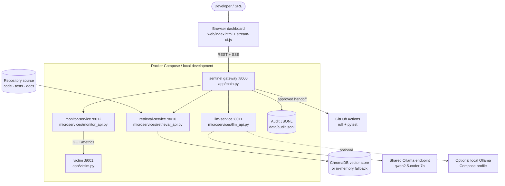
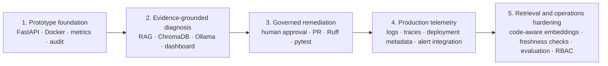

# AIOps Sentinel — Workflow and Tooling

This is the operating workflow for AIOps Sentinel: detect an application incident, connect it to reviewable source-code evidence, propose a safe remediation, and leave the final decision with an engineer.

## End-to-end incident workflow

```mermaid
flowchart LR
    operator([Developer / operator])
    browser["Sentinel dashboard<br/>HTML + JavaScript"]
    load["Safe incident simulator<br/>scripts/simulate_incident.py"]
    app["Victim order service<br/>FastAPI / Uvicorn :8001"]
    metrics["/metrics<br/>request count · error rate · p95 latency"]
    gateway["Sentinel gateway<br/>FastAPI / Uvicorn :8000"]
    monitor["Monitoring service<br/>httpx + psutil :8012"]
    decision{"Threshold breached?"}
    normal["Return healthy status<br/>continue monitoring"]
    question["Create bounded incident question<br/>endpoint · metrics · symptom"]
    retrieval["Retrieval service :8010<br/>Repository index"]
    index["Source repository<br/>app · services · tests · docs"]
    vector["ChromaDB persistence<br/>hash embeddings + cosine ranking"]
    evidence["Ranked evidence<br/>file · line range · score"]
    llm["LLM service :8011<br/>guarded RAG prompt"]
    ollama["Ollama<br/>qwen2.5-coder:7b"]
    diagnosis["Explainable diagnosis<br/>cause · uncertainty · safe test/fix proposal"]
    review{"Human approves<br/>the handoff?"}
    revise["Request more evidence,<br/>adjust proposal, or close incident"]
    audit["Append audit event<br/>data/audit.jsonl"]
    ci["Reviewable pull request<br/>GitHub Actions: ruff + pytest"]
    merge{"Human code review<br/>and merge approval?"}
    deploy["Existing delivery process<br/>deploy / restart only after approval"]

    operator --> browser --> gateway
    load --> app
    app --> metrics --> monitor
    gateway --> monitor
    monitor --> decision
    decision -- No --> normal --> audit
    decision -- Yes --> question --> retrieval
    index --> retrieval
    retrieval <--> vector
    retrieval --> evidence --> llm --> ollama --> llm
    llm --> diagnosis --> browser
    diagnosis --> review
    review -- No --> revise --> audit
    review -- Yes --> audit --> ci --> merge
    merge -- No --> revise
    merge -- Yes --> deploy
```

### What happens at each decision point

| Stage | Trigger / output | Tools used now | Safety boundary |
| --- | --- | --- | --- |
| Observe | The victim app exposes request count, error rate, and p95 latency. | FastAPI, Uvicorn | Metrics are read-only. |
| Detect | A check flags an incident at error rate >= 10% or p95 >= 600 ms (configurable). | `httpx`, `psutil`, monitoring service | A threshold starts analysis; it does not change the application. |
| Investigate | The incident question retrieves the most relevant repository chunks. | Repository index, ChromaDB when installed, deterministic embedding fallback | Evidence is shown with file paths and line ranges. |
| Diagnose | A guarded prompt produces a cited explanation, uncertainty, proposed test, and safe remediation. | Ollama, `qwen2.5-coder:7b`, LLM service | The model is instructed to use supplied evidence only and never claim a fix was applied. |
| Review | An operator accepts, rejects, or asks for more investigation. | Dashboard, approval API | Named human approval is required before CI/CD handoff. |
| Validate | A proposed code change is reviewed in a pull request and checked. | GitHub Actions, Ruff, pytest | CI is validation only; passing CI is not permission to merge. |
| Deliver | The normal engineering release process deploys an approved change. | Existing CI/CD platform | Sentinel does not automatically merge, restart, scale, or deploy. |

## Runtime architecture

## Tooling inventory

| Concern | Selected tools | Role in the workflow |
| --- | --- | --- |
| API and service runtime | Python, FastAPI, Uvicorn, Pydantic | Runs the gateway, victim service, and independent monitoring/retrieval/LLM APIs. |
| Dashboard | HTML, CSS, JavaScript, Server-Sent Events | Streams an answer while keeping metrics, retrieved evidence, and approval visible to the reviewer. |
| Telemetry collection | `httpx`, `psutil`, application `/metrics` endpoint | Fetches service metrics and local process resource data. |
| Source-code retrieval | Custom chunker, deterministic 128-dimension hashing embeddings, ChromaDB | Indexes repository files and ranks likely evidence; ChromaDB persistence is optional, with an in-memory fallback. |
| AI reasoning | Ollama, `qwen2.5-coder:7b` | Produces an evidence-grounded diagnosis through the LLM microservice. |
| Packaging and service orchestration | Docker, Docker Compose | Starts the gateway, victim, monitor, retrieval, and LLM proxy together. |
| Code quality and validation | Ruff, pytest, GitHub Actions | Lints and tests proposed changes after a human authorizes the handoff. |
| Auditability | JSON Lines (`data/audit.jsonl`) | Preserves monitor checks, retrieval, diagnosis, questions, and approvals. |
| Optional code search | Sourcegraph OSS Compose profile | Optional repository exploration; it is not on the critical diagnosis path today. |

## Delivery plan

The first three phases are in the current prototype. The final two are the recommended path to a production-ready system.

### Planned production additions

| Priority | Addition | Why it matters |
| --- | --- | --- |
| High | Connect alerting, logs, traces, and deployment metadata. | A p95 breach is stronger when correlated with a rollout, error logs, and a trace. |
| High | Re-index on commit and show index commit/version. | Prevents diagnosis from relying on stale code. |
| High | Replace or augment lightweight hashing embeddings with a code-aware embedding model; rerun the fixed evaluation set. | Current retrieval is intentionally a prototype and needs higher measured recall and precision. |
| High | Authenticate users and apply role-based approval permissions. | Makes approval records meaningful outside a demo. |
| Medium | Create a draft PR with the diagnosis, citations, proposed patch, and test result. | Keeps automation reviewable while reducing manual handoff work. |
| Medium | Add alert deduplication, incident lifecycle states, and notification routing. | Avoids repeated analysis and makes ownership clear. |
| Medium | Publish audit events to durable centralized storage. | JSONL is transparent for the demo; a production system needs retention, access control, and search. |

## Operating rule

Evidence can inform an incident response; it cannot authorize one. AIOps Sentinel may monitor, retrieve, explain, propose, and record. A qualified human must approve the handoff, review the code, and authorize deployment.
